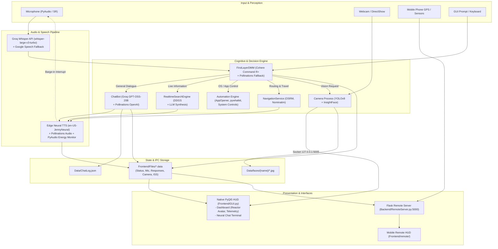

# F.R.I.D.A.Y. (Female Replacement Intelligent Digital Assistant Youth)
## Comprehensive Technical Documentation & Architecture Reference
**Version:** 3.0 (Neural HUD Edition)  
**Author:** Pruthvi Joshi  
**Repository:** [github.com/joshibhai13/F.R.I.D.A.Y](https://github.com/joshibhai13/F.R.I.D.A.Y)  
**Last Updated:** November 2026  

---

## Table of Contents
1. [Executive Summary & System Vision](#1-executive-summary--system-vision)
2. [High-Level System Architecture](#2-high-level-system-architecture)
3. [Deep-Dive Module Breakdown](#3-deep-dive-module-breakdown)
   - [3.1 Main Lifecycle & Orchestration (`main.py`)](#31-main-lifecycle--orchestration-mainpy)
   - [3.2 Speech-to-Text Pipeline (`Backend/SpeechToText.py`)](#32-speech-to-text-pipeline-backendspeechtotextpy)
   - [3.3 Text-to-Speech & Barge-In Interruption (`Backend/TextToSpeech.py`)](#33-text-to-speech--barge-in-interruption-backendtexttospeechpy)
   - [3.4 Conversational AI & Hinglish Dialogue (`Backend/Chatbot.py`)](#34-conversational-ai--hinglish-dialogue-backendchatbotpy)
   - [3.5 Real-Time Search & Web Intelligence (`Backend/RealtimeSearchEngine.py`)](#35-real-time-search--web-intelligence-backendrealtimesearchenginepy)
   - [3.6 Intent Classification & Decision Making (`Backend/Model.py`)](#36-intent-classification--decision-making-backendmodelpy)
   - [3.7 Pollinations.ai Integration Suite (`Backend/PollinationsAI.py`, `Backend/ImageGeneration.py`)](#37-pollinationsai-integration-suite)
   - [3.8 System Automation & Task Execution (`Backend/Automation.py`)](#38-system-automation--task-execution-backendautomationpy)
   - [3.9 Computer Vision, Face Recognition & Headcount Tracking (`Backend/camera.py`)](#39-computer-vision-face-recognition--headcount-tracking-backendcamerapy)
   - [3.10 Geolocation, OSRM Routing & Navigation (`Backend/NavigationService.py`)](#310-geolocation-osrm-routing--navigation-backendnavigationservicepy)
   - [3.11 Deep Space Telemetry & Scheduling (`Backend/SpaceAPI.py`, `Backend/Scheduler.py`)](#311-deep-space-telemetry--scheduling)
   - [3.12 Unified Remote Server & Mobile Gateway (`Backend/RemoteServer.py`)](#312-unified-remote-server--mobile-gateway-backendremoteserverpy)
   - [3.13 Native Desktop PyQt5 HUD Interface (`Frontend/GUI.py`)](#313-native-desktop-pyqt5-hud-interface-frontendguipy)
   - [3.14 Mobile Web Remote Dashboard (`Frontend/remote/`)](#314-mobile-web-remote-dashboard-frontendremote)
4. [Inter-Process Communication (IPC) & Data Stores](#4-inter-process-communication-ipc--data-stores)
5. [Hardware & Network Interfaces](#5-hardware--network-interfaces)
6. [Environment Variables & Configuration (`.env`)](#6-environment-variables--configuration-env)
7. [Installation & Deployment Guide](#7-installation--deployment-guide)
8. [Complete Voice & Text Command Reference](#8-complete-voice--text-command-reference)
9. [Troubleshooting & Maintenance](#9-troubleshooting--maintenance)

---

## 1. Executive Summary & System Vision
**F.R.I.D.A.Y.** is an intelligent, multimodal personal AI assistant designed to emulate the responsive, autonomous, and contextual nature of Tony Stark's cinematic AI. Unlike standard cloud-only voice assistants, F.R.I.D.A.Y. integrates local hardware execution, edge computer vision, real-time web telemetry, deep space observation, home/system automation, and cross-platform remote command capabilities into a unified ecosystem.

### Core Capabilities:
- **Instant Multilingual Speech Interaction**: Sub-second voice recognition powered by Groq Whisper (`whisper-large-v3-turbo`) with native support for English and Hinglish (Hindi written in Roman script).
- **Speech Interruption (Barge-In)**: Natural conversation flow where user voice activity automatically interrupts AI speech in real time.
- **Failover Redundancy**: Multi-tiered AI pipeline with Groq and Cohere primary engines backed up by Pollinations.ai and Google fallback services.
- **Real-Time Computer Vision**: YOLOv8-powered object detection and moving person headcount tracking, paired with InsightFace 512-d biometric recognition and on-the-fly facial learning.
- **Space & Earth Intelligence**: NASA APOD dynamic wallpaper sync, Mars Rover imagery, JWST/Hubble observation feeds, asteroid threat monitoring, ISS tracking, and turn-by-turn OSRM GPS navigation.
- **Dual-Interface Architecture**: Zero-latency native PyQt5 desktop HUD combined with a Flask-powered mobile web command center.

---

## 2. High-Level System Architecture



---

## 3. Deep-Dive Module Breakdown

### 3.1 Main Lifecycle & Orchestration (`main.py`)
`main.py` serves as the primary process supervisor and coordinates background execution threads:

1. **`FirstThread()`**: The core artificial intelligence loop.
   - Constantly checks `GetMicrophoneStatus()`. If active, transitions assistant status to `Listening...` and invokes `SpeechRecognition()`.
   - Passes transcription to `FirstLayerDMM(query)` for intent classification.
   - Dispatches tasks to appropriate handlers:
     - Combined general/realtime search queries.
     - Single decision paths (`general`, `realtime`, `content`, `generate image`, `learn face`, `switch camera`, `camera`, `close camera`, `where am i`, `navigate to`, `traffic to`, `exit`).
     - Emits responses to `ShowTextToScreen()`, updates status to `Answering...`, and invokes `TextToSpeech()`.
2. **`run_server()`**: Starts `start_remote_server(port=5000)` in a daemon thread.
3. **`advanced_startup_greeting()`**:
   - Gathers time of day, location, current temperature, and meteorological conditions via `Backend.SpaceAPI`.
   - Reads conversation history from `Data/ChatLog.json` to extract context from the last session.
   - Prompts Groq LLM to generate an engaging, personalized startup briefing suggesting appropriate attire and referencing recent topics.
4. **`SecondThread()`**: Runs `GraphicalUserInterface()` on the main thread, executing the native PyQt5 event loop.

---

### 3.2 Speech-to-Text Pipeline (`Backend/SpeechToText.py`)
Provides fast, accurate multilingual speech recognition tailored for English and Hinglish:

- **Primary Engine**: Groq Whisper API (`whisper-large-v3-turbo`).
  - Converts microphone audio to 16-bit PCM WAV in memory (`io.BytesIO`).
  - Conditioned with conversational prompt:  
    `"Hinglish conversation. Hindi words written in English alphabet (Roman script). Examples: kya kar rahe ho, kaise ho, what is the weather..."`
  - Transcribes Hindi speech directly into phonetically spelled English text (e.g., *"kaise ho"* instead of Devanagari script).
- **Phonetic Transliterator Fallback (`devanagari_to_hinglish()`)**:
  - Scans for Unicode characters in range `\u0900`–`\u097F`.
  - Maps vowels, consonants, matras, and conjuncts into standardized Roman letters so output remains readable on all displays.
- **Secondary Engine**: Google Speech Recognition via `SpeechRecognition` library (`en-IN` / `hi-IN` fallback).
- **`QueryModifier()`**: Automatically determines sentence structure, capitalizing the first letter and appending appropriate question marks (`?`) or periods (`.`) based on interrogative keywords in English and Hindi (`what`, `how`, `kya`, `kaise`, `kyun`, `kab`, `kahan`, `kaun`).

---

### 3.3 Text-to-Speech & Barge-In Interruption (`Backend/TextToSpeech.py`)
Handles speech synthesis, audio output, and dynamic barge-in interruption:

- **Primary Engine**: Microsoft Edge Neural TTS (`edge_tts`), utilizing the high-clarity `en-US-JennyNeural` voice.
- **Playback Architecture**: Pygame mixer audio stream.
  - Generates temp `.mp3` files via an isolated asyncio event loop (`asyncio.new_event_loop()`).
  - Unloads audio files explicitly with `pygame.mixer.music.unload()` before deletion, completely eliminating Windows `[WinError 32]` file access conflicts.
- **Barge-In (Speech Interruption)**:
  - While audio is playing, a daemon thread runs `_monitor_interruption()`.
  - Reads 1024-byte audio chunks from the microphone using PyAudio.
  - Calculates Root Mean Square (RMS) energy via Python's standard `audioop.rms()`.
  - If RMS volume exceeds voice threshold `1100` over consecutive samples, it immediately triggers `StopSpeaking()`, halting playback and releasing audio locks.
- **Failover Engines**:
  - **Secondary**: Pollinations Audio API (`https://gen.pollinations.ai/audio/{text}?voice=nova`).
  - **Offline Safety Net**: Windows SAPI5 via `pyttsx3`.

---

### 3.4 Conversational AI & Hinglish Dialogue (`Backend/Chatbot.py`)
Handles general conversational intelligence, contextual memory, and dynamic language matching:

- **Primary Engine**: Groq `openai/gpt-oss-20b` (temperature: 0.7, max tokens: 1024).
- **Secondary Engine**: Pollinations.ai chat completion (`generate_chat_completion()` with `model="openai"`).
- **Language Adaptation Rules**:
  - Automatically identifies whether the user is speaking English or Hindi/Hinglish.
  - Dynamically responds in natural Hinglish when queried in Hindi/Hinglish (e.g., *"Haan sir, bilkul! Main abhi kar deta hoon."*).
  - Responds in crisp, professional English when queried in English.
  - Strictly prohibits Devanagari output to ensure consistent pronunciation across TTS engines.
- **Context Management**: Injects real-time timestamp information (day, date, year, hours, minutes, seconds) and persists conversations in `Data/ChatLog.json` (sliding window of the last 12 turns).

---

### 3.5 Real-Time Search & Web Intelligence (`Backend/RealtimeSearchEngine.py`)
Provides up-to-the-minute factual information from the internet:

- **Search Engine**: DuckDuckGo Search API (`DDGS().text()`) queried across region `in-en`.
- **Context Synthesis**: Extracts top 8 search results (titles, descriptions, links), injects current temporal data, and submits context to Groq's `openai/gpt-oss-20b` (or Pollinations fallback) with `temperature=0.4` for factual accuracy.
- **Hinglish Synthesis**: If the search prompt was in Hindi or Hinglish, the synthesized response is formulated in Hinglish.

---

### 3.6 Intent Classification & Decision Making (`Backend/Model.py`)
Acts as F.R.I.D.A.Y.'s cognitive routing cortex (First Layer Decision Making Model):

- **Primary Classifier**: Cohere Command R+ (`command-r-plus`).
- **Secondary Classifier**: Pollinations.ai chat completion.
- **Classification Categories**:
  - `general <query>`: Conversational chit-chat, reasoning, explanations.
  - `realtime <query>`: Current events, live scores, weather, stock prices, news.
  - `open <app>`, `close <app>`: Software lifecycle management.
  - `play <media>`: YouTube video/song streaming.
  - `generate image <prompt>`: AI image synthesis.
  - `system <command>`: Volume, mute, brightness, power state, screenshots.
  - `content <topic>`: Long-form essay/article drafting.
  - `google search <query>`, `youtube search <query>`: Direct browser queries.
  - `camera`, `close camera`, `switch camera`, `learn face <name>`: Vision controls.
  - `where am i`, `navigate to <dest>`, `navigate home`, `traffic to <dest>`: Location services.
  - `exit`: System shutdown.
- **Fallback Logic**: If the classifier returns empty or ambiguous tags, it safely defaults to `["general " + prompt]`.

---

### 3.7 Pollinations.ai Integration Suite
A unified wrapper supporting LLMs and generative image synthesis:

#### `Backend/PollinationsAI.py`:
- Connects to `https://gen.pollinations.ai` authenticated with the user's API key.
- `generate_chat_completion(messages)`: Calls `/v1/chat/completions` with automatic fallback to `/text/{prompt}`.
- `generate_image_url(prompt)`: Formats high-resolution image URLs with model selection (`flux`, `turbo`), custom seeds, and dimensions.

#### `Backend/ImageGeneration.py`:
- Reads pending prompt requests from `Frontend/Files/ImageGeneration.data`.
- Generates 2 unique image variants concurrently using Python `ThreadPoolExecutor`.
- Primary engine uses Pollinations FLUX; secondary fallback uses Hugging Face Inference API (`stabilityai/stable-diffusion-xl-base-1.0`).
- Saves generated images to `Data/Images/` and opens them automatically using Pillow.

---

### 3.8 System Automation & Task Execution (`Backend/Automation.py`)
Executes direct operating system actions asynchronously:

- **App Management**: Opens and closes Windows applications cleanly via `AppOpener`.
- **Media Automation**: Searches and autoplays YouTube streams via `pywhatkit.playonyt()`.
- **Windows System Controls**:
  - Mute/Unmute toggle, Volume Up/Down (+/- 10 steps via keyboard simulation).
  - Brightness Up/Down adjustments via PowerShell WmiMonitorBrightnessMethods.
  - Lock workstation (`user32.LockWorkStation`).
  - Sleep mode (`rundll32.exe powrprof.dll,SetSuspendState`).
  - Screenshot capture saved to desktop (`pyautogui.screenshot`).
- **Content Writer**: Generates long-form structured content via Groq LLM and opens it in Notepad.

---

### 3.9 Computer Vision, Face Recognition & Headcount Tracking (`Backend/camera.py`)
An independent vision process communicating with the main application via TCP sockets:

- **Face Recognition**: InsightFace `buffalo_l` suite (detection, 2D/3D landmarks, gender/age, ArcFace `w600k_r50` 512-dimensional embeddings).
- **Biometric Database**: Reads image files from `Data/faces/{person_name}/` and builds reference embeddings with cosine similarity matching (threshold: `0.45`).
- **On-the-Fly Face Learning**: Voice command `"learn face <name>"` captures a webcam frame via OpenCV DirectShow, creates a named directory in `Data/faces/`, and reloads the face database instantly.
- **Headcount & People Tracking**:
  - Uses YOLOv8n tracking (`model.track(persist=True, classes=[0])`) to detect persons.
  - Tracks unique person IDs across frames using a spatial tracking set (`unique_people_ids`).
  - HUD overlay displays:
    - **Total Headcount**: Cumulative unique persons observed.
    - **Verified Count**: Detected faces matching enrolled identities.
    - **Unverified Count**: Detected faces not yet enrolled in the database.
- **Camera Switching**: Voice command `"switch camera"` cycles camera indices (0, 1, 2) saved to `Frontend/Files/CameraIndex.data` using Windows DirectShow backend (`cv2.CAP_DSHOW`).
- **IPC Video Streaming**: Serializes annotated frames into binary payloads and streams them over `127.0.0.1:5005` to the desktop GUI.

---

### 3.10 Geolocation, OSRM Routing & Navigation (`Backend/NavigationService.py`)
Comprehensive mapping, routing, and location intelligence:

- **Coordinates & Reverse Geocoding**: Queries OpenStreetMap Nominatim API to translate latitude/longitude into human-readable city, street, and postal details.
- **Route Computation (OSRM)**: Calculates driving routes using Open Source Routing Machine (`router.project-osrm.org`), returning:
  - Exact travel distance in kilometers.
  - Estimated duration in minutes.
  - 8-point compass bearing (N, NE, E, SE, S, SW, W, NW).
  - Step-by-step turn instructions.
- **Live Phone GPS Integration**: Mobile devices stream GPS coordinates to `/api/location`, allowing F.R.I.D.A.Y. to compute routes from your phone's live position to home or destinations.
- **Traffic & Weather Synthesis**: Integrates route duration with live destination weather conditions.

---

### 3.11 Deep Space Telemetry & Scheduling
Astronomy data feeds and scheduled tasks:

#### `Backend/SpaceAPI.py`:
- **NASA APOD**: Fetches daily Astronomy Picture of the Day with high-resolution imagery and scientific descriptions.
- **Mars Surface**: Pulls latest rover imagery (Curiosity/Perseverance) by Martian sol.
- **Telescopes**: Randomizes deep-space observation sets from the James Webb Space Telescope (JWST) and Hubble Space Telescope.
- **Asteroid Monitor**: Queries NASA NeoWs (Near Earth Object Web Service) for miss distance and hazardous asteroid classifications.
- **Orbital Launches**: Tracks upcoming global satellite and crewed rocket launches with real-time countdown timers.
- **ISS Tracker**: Fetches live geographic coordinates of the International Space Station (`open-notify.org`) and saves status to `Frontend/Files/ISS.data`.

#### `Backend/Scheduler.py`:
- Runs background cron jobs:
  - Updates desktop wallpaper daily at 09:00 with NASA's APOD image.
  - Periodically refreshes space telemetry caches.

---

### 3.12 Unified Remote Server & Mobile Gateway (`Backend/RemoteServer.py`)
Flask server exposing secure RESTful endpoints for local network and remote control:

- **Security & Auth**: Protected by Bearer token (`REMOTE_TOKEN`). Localhost (`127.0.0.1`) requests are auto-authorized to streamline local desktop access.
- **Key API Endpoints**:
  - `GET /api/status`: Returns assistant operating status, microphone active state, and user details.
  - `GET /api/live`: Real-time telemetry endpoint polling assistant state, microphone state, vision activity, and the last 25 chat entries from `ChatLog.json`.
  - `POST /api/command`: Dispatches natural language queries into the full DMM cognitive pipeline.
  - `POST /api/chat`: Direct AI conversation endpoint with base64 audio response streaming.
  - `POST /api/mic/toggle`: Toggles speech recognition listening state on/off.
  - `POST /api/stop`: Halts active TTS voice output instantly.
  - `POST /api/system`: Triggers OS system controls.
  - `GET /api/screenshot`: Captures and returns a live PNG screenshot of the desktop.
  - `POST /api/location`: Ingests GPS coordinates from mobile phones.
  - `POST /api/camera/analyze`: Receives mobile camera frames, runs YOLOv8 detection, and generates an auditory summary.
- **Tunneling**: Supports automatic ngrok HTTPS tunnel generation via included `ngrok.exe`.

---

### 3.13 Native Desktop PyQt5 HUD Interface (`Frontend/GUI.py`)
A fast, hardware-accelerated desktop application window with zero browser overhead:

- **Window Metrics**: 1260×800 centered desktop window with frameless dark titanium styling and mouse drag support.
- **Top Bar**:
  - `⚡ F.R.I.D.A.Y.` glowing cyan title logo.
  - Segmented navigation switcher: `[ 🎛️ HUD Dashboard ]` and `[ 💬 Chat Terminal ]`.
  - Window control actions (Minimize, Maximize/Restore, Close).
- **HUD Dashboard View**:
  - **Center**: Animated Arc Reactor core (`Jarvis.gif`), real-time status label (`AVAILABLE`, `LISTENING...`, `THINKING...`, `ANSWERING...`), interactive glowing Mic button (green when active, red when paused), and a **Stop Voice Playback** barge-in button.
  - **Left**: Live Vision Mode camera stream card with quick `Toggle Vision` and `Switch Camera` controls, plus weather and sensor telemetry.
  - **Right**: Deep Space imagery card (JWST) and instant system action controls (Mute, Vol +/-, Screenshot, Files).
- **Neural Chat Terminal View**:
  - Styled chat scroll area with modern glass bubble cards:
    - User messages: Right-aligned violet/indigo glass cards tagged with `👤 PRUTHVI`.
    - Assistant messages: Left-aligned cyan/azure glass cards tagged with `⚡ FRIDAY`.
  - **Integrated Prompt Input Bar**:
    - Bottom `QLineEdit` prompt bar: *"Ask FRIDAY anything in English or Hinglish..."*
    - `Transmit ▶` button and `🎤` mic toggle button.
    - Asynchronous `ChatWorker` thread: User can type questions and receive streamed responses and voice playback without freezing the UI.
    - Synchronizes automatically with voice conversations captured via microphone in `main.py`.

---

### 3.14 Mobile Web Remote Dashboard (`Frontend/remote/`)
A responsive web application accessible from smartphones and tablets over the local network:

- **Files**: `index.html`, `style.css`, `app.js`.
- **Aesthetic**: Sci-Fi dark glassmorphic interface with particle animations, glowing status orb, and responsive widget layout.
- **Mobile Vision & Scanner**: Uses device camera via HTML5 `navigator.mediaDevices.getUserMedia` to capture photos, send them to `/api/camera/analyze`, and receive object bounding counts with spoken audio.
- **Mobile GPS Beacon**: Streams real-time geolocation coordinates to the server so F.R.I.D.A.Y. knows your exact position relative to your computer.

---

## 4. Inter-Process Communication (IPC) & Data Stores

```
c:\Users\pruth\Desktop\jarvis\
├── Data/
│   ├── ChatLog.json             # Persistent multi-turn dialogue history
│   ├── faces/                   # Biometric facial database
│   │   └── {Person_Name}/
│   │       └── {Person_Name}.jpg
│   └── Images/                  # Generated AI imagery from Pollinations/HF
└── Frontend/
    └── Files/                   # Fast IPC state exchange files
        ├── Status.data          # Current assistant status (Listening, Thinking, etc.)
        ├── Mic.data             # Microphone listening state (True / False)
        ├── Responses.data       # Latest speech text output for GUI sync
        ├── Camera.data          # Vision mode active state (True / False)
        ├── CameraIndex.data     # Active camera device index (0, 1, 2)
        ├── HologramObject.data  # Current target for 3D wireframe projection
        ├── ImageGeneration.data # IPC request queue for image synthesis
        └── ISS.data             # Real-time International Space Station coords
```

---

## 5. Hardware & Network Interfaces

| Interface | Protocol / Library | Configuration & Details |
| :--- | :--- | :--- |
| **Microphone Input** | PyAudio / SpeechRecognition | 16 kHz sample rate, 16-bit PCM, dynamic noise calibration, 0.8s pause threshold |
| **Audio Playback** | Pygame Mixer (SDL 2.0.22) | MP3 stream playback, explicit `unload()` before file deletion |
| **Webcam / Camera** | OpenCV (`cv2.VideoCapture`) | Windows DirectShow backend (`cv2.CAP_DSHOW`), multi-camera indexing (0, 1, 2) |
| **Vision IPC Stream** | TCP Socket (`127.0.0.1:5005`) | Binary length-prefixed JPEG frames streamed from `camera.py` to `GUI.py` |
| **Local Web Server** | Flask + pyOpenSSL (`0.0.0.0:5000`) | Self-signed adhoc SSL certificate to enable mobile HTTPS & WebRTC camera |
| **Global Tunneling** | ngrok HTTP Tunnel | Maps `https://localhost:5000` to public URL for remote access |
| **Cloud Model APIs** | HTTPS REST | Groq, Cohere, Pollinations.ai, Hugging Face, OpenStreetMap, NASA NeoWs |

---

## 6. Environment Variables & Configuration (`.env`)

Create a `.env` file in the root directory with the following variables:

```ini
# --- Core Identity & Keys ---
Username = Pruthvi Joshi
Assistantname = FRIDAY
InputLanguage = en-IN
AssistantVoice = en-US-JennyNeural

# --- Primary Cognitive APIs ---
GroqAPIKey = gsk_...                      # High-speed LLM & Whisper STT
CohereAPIKey = Tj7V3...                   # Decision-Making Intent Model (DMM)
PollinationsAPIKey = sk_...               # Redundant LLM, Flux Image Gen, Audio TTS

# --- Secondary & Fallback Services ---
HuggingFaceAPIKey = hf_...                # Secondary image generation
DEEPGRAM_API_KEY = 0da35...               # Optional fallback STT
ASSEMBLYAI_API_KEY = abf0e...             # Optional fallback STT
REPLICATE_API_TOKEN = r8_...              # Optional image/video models

# --- Remote Server Security ---
REMOTE_TOKEN = jarvis2026                 # Mobile dashboard bearer token

# --- Automation & Messaging (Optional) ---
INSTAGRAM_USERNAME = your_username
INSTAGRAM_PASSWORD = your_password
SENDER_EMAIL = your_email@gmail.com
EMAIL_PASSWORD = your_app_password
TWILIO_ACCOUNT_SID = AC...
TWILIO_AUTH_TOKEN = ...
TWILIO_PHONE_NUMBER = +1...
```

---

## 7. Installation & Deployment Guide

### Prerequisites
- **Operating System**: Windows 10 / 11 (64-bit).
- **Python**: Python 3.10.x (Recommended: Python 3.10.11).
- **Hardware**: Dedicated NVIDIA GPU recommended for YOLO / InsightFace; runs smoothly on CPU.
- **Audio**: Working microphone and stereo speakers/headphones.

### Setup Instructions

1. **Clone the Repository**:
   ```powershell
   git clone https://github.com/joshibhai13/F.R.I.D.A.Y.git
   cd F.R.I.D.A.Y
   ```

2. **Create and Activate Virtual Environment**:
   ```powershell
   python -m venv .venv
   .\.venv\Scripts\Activate.ps1
   ```

3. **Install Core Dependencies**:
   ```powershell
   pip install -r Requirements.txt
   pip install speechrecognition pyaudio insightface ultralytics
   ```

4. **Configure Environment Keys**:
   Copy `.env.example` to `.env` and fill in your API credentials:
   ```powershell
   Copy-Item .env.example .env
   ```

5. **Launch F.R.I.D.A.Y.**:
   ```powershell
   python main.py
   ```

---

## 8. Complete Voice & Text Command Reference

### Conversational & General
| Voice / Text Command | Description | Example Response |
| :--- | :--- | :--- |
| *"Hello FRIDAY"* | Standard greeting & system status | *"Welcome Pruthvi. All systems are operational."* |
| *"Kaise ho aap?"* | Hinglish conversation query | *"Main bilkul badhiya hoon sir! Aap bataiye aaj kya plan hai?"* |
| *"What is quantum computing?"* | In-depth technical reasoning | Full conversational explanation formatted crisply. |

### Real-Time Search & Live Data
| Voice / Text Command | Description | Example Response |
| :--- | :--- | :--- |
| *"Who won the match yesterday?"* | Fetches live sports results | Synthesizes current web data from DuckDuckGo. |
| *"What is the stock price of Apple?"* | Live financial market check | Returns up-to-the-minute market valuation. |
| *"Aaj ka weather kaisa hai?"* | Real-time weather in Hinglish | *"Surat mein aaj dhoop nikli hai aur temperature 28 degrees hai."* |

### System & App Automation
| Voice / Text Command | Description | Action Taken |
| :--- | :--- | :--- |
| *"Open Chrome"* / *"Close Chrome"* | Launches or terminates application | Executes via `AppOpener`. |
| *"Play Interstellar soundtrack"* | Autoplays music on YouTube | Launches default browser directly into YouTube. |
| *"Take a screenshot"* | Captures entire desktop display | Saves PNG to your Desktop folder. |
| *"Volume up"* / *"Volume down"* | Adjusts system audio levels | Simulates keyboard volume steps (+/- 10). |
| *"Mute system"* / *"Unmute system"* | Toggles master audio mute | Toggles master sound card state. |
| *"Lock screen"* | Locks Windows workstation | Calls Windows `LockWorkStation`. |

### Vision & Facial Biometrics
| Voice / Text Command | Description | Action Taken |
| :--- | :--- | :--- |
| *"Open camera"* / *"Vision Mode"* | Starts Vision subprocess | Opens real-time YOLOv8 object tracking window. |
| *"Close camera"* | Terminates Vision subprocess | Closes camera feed and releases hardware. |
| *"Switch camera"* | Cycles webcam indices (0 → 1 → 2) | Switches from laptop webcam to external USB camera. |
| *"Learn face Pruthvi"* | Enrolls new biometric face identity | Captures current frame, stores in `Data/faces/Pruthvi/`. |

### Navigation & Geolocation
| Voice / Text Command | Description | Action Taken |
| :--- | :--- | :--- |
| *"Where am I?"* | Reports current laptop location | Returns neighborhood, city, and local weather. |
| *"Navigate to Mumbai"* | Calculates driving route from phone | Returns distance in km, ETA in minutes, and bearing. |
| *"Traffic to Airport"* | Estimates commute duration & traffic | Combines OSRM travel time with destination weather. |
| *"Navigate home"* | Routes phone back to laptop base | Generates turn-by-turn guidance to laptop location. |

### Generative Media
| Voice / Text Command | Description | Action Taken |
| :--- | :--- | :--- |
| *"Generate image of a futuristic cyberpunk city"* | Synthesizes 2 image variants | Generates concurrently via Pollinations FLUX & opens image. |
| *"Write content on Artificial General Intelligence"* | Writes long-form essay | Formulates article and opens directly in Notepad. |

### Utilities & Productivity
| Voice / Text Command | Description | Action Taken |
| :--- | :--- | :--- |
| *"What is my IP address"* | Reports public and local network IP | Fetches IP dynamically and speaks result. |
| *"Support"* / *"GitHub Support"* | Opens project support issues page | Launches default browser directly to GitHub Issues. |
| *"Wikipedia search [topic]"* | Reads 2-sentence Wikipedia summary | Uses `wikipedia` library to summarize and speak answer. |
| *"Write a note [content]"* | Saves timestamped user note | Appends note to `Data/notes.txt` and opens in Notepad. |
| *"Show notes"* / *"Read notes"* | Reads back recent user notes | Reads back last 3 recorded notes and opens Notepad. |
| *"Read PDF"* | Reads text from documents | Extracts text from first pages of PDF in `Data/` using `pypdf`. |
| *"How to [task]"* / *"How-To Mode"* | Multi-step procedural guide | Formulates 4-5 actionable steps via Groq / Pollinations. |
| *"Toss a coin"* / *"Flip coin"* | Simulates fair coin toss | Randomly selects Heads or Tails and announces result. |
| *"Send a message"* | WhatsApp messaging | Dispatches to WhatsApp Web with target phone/message. |
| *"Send email"* | Dispatches email | Sends via SMTP (or opens Gmail web fallback). |
| *"Change window"* / *"Switch window"* | Window switcher | Simulates `Alt+Tab` to toggle active Windows application. |
| *"Sleep now"* / *"Standby"* | Assistant standby mode | Turns off active microphone listening until toggled back on. |

---

## 9. Troubleshooting & FAQ

### 1. `[WinError 32] The process cannot access the file because it is being used by another process`
- **Cause**: Pygame audio mixer holding an open file handle on Windows while trying to delete temporary audio files.
- **Resolution**: Resolved in `Backend/TextToSpeech.py` by calling `pygame.mixer.music.unload()` before removing files.

### 2. Camera Fails to Switch or Shows Black Screen
- **Cause**: Windows default video capture backend timing out.
- **Resolution**: `Backend/camera.py` and `main.py` enforce `cv2.CAP_DSHOW` (DirectShow), which provides instant device switching between internal and external webcams.

### 3. Speech Recognition Not Picking Up Hindi Words
- **Cause**: Legacy Google STT was locked to English phonetic parsing.
- **Resolution**: Upgraded to Groq Whisper (`whisper-large-v3-turbo`) with Hinglish system prompts and phonetic Devanagari transliteration.

### 4. Remote Dashboard Shows "Not Secure" Warning
- **Cause**: Local Flask server uses an adhoc self-signed certificate to enable WebRTC camera capture on mobile browsers.
- **Resolution**: Click *"Advanced" -> "Proceed to localhost (unsafe)"* in your mobile browser, or use the ngrok URL generated in the console.

---
*F.R.I.D.A.Y. Assistant Architecture Document — Maintained by Pruthvi Joshi.*
