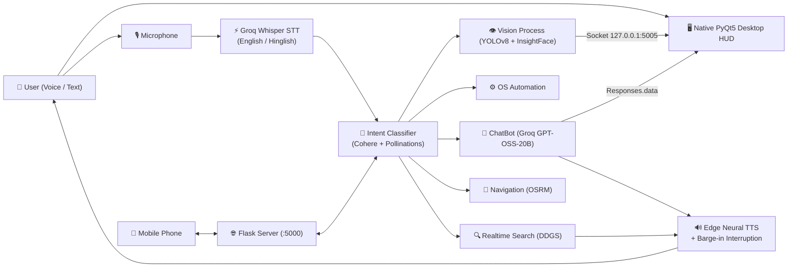

# ⚡ F.R.I.D.A.Y. (Female Replacement Intelligent Digital Assistant Youth)
### Advanced Multimodal Desktop AI Assistant & Neural HUD

[](https://www.python.org/downloads/)
[](https://pypi.org/project/PyQt5/)
[](https://groq.com/)
[](https://github.com/rany2/edge-tts)
[](https://github.com/ultralytics/ultralytics)
[](https://pollinations.ai/)

**F.R.I.D.A.Y.** is an intelligent, multimodal personal AI assistant built with Python and PyQt5. Designed to emulate the responsive, autonomous, and conversational nature of Tony Stark's cinematic AI, F.R.I.D.A.Y. acts as a central hub for voice interaction, home/system automation, real-time computer vision, deep space telemetry, and mobile remote control.

📖 **For full architecture diagrams, module references, and technical specifications, see [DOCUMENTATION.md](DOCUMENTATION.md).**

---

## 🌟 Key Features

### 🎙️ Advanced Voice Intelligence (Hinglish + Speech Interruption)
- **Groq Whisper STT (`whisper-large-v3-turbo`)**: Sub-second, high-accuracy speech recognition across 100+ languages.
- **Fluent Hinglish Support**: Speak in Hindi or Hinglish, and F.R.I.D.A.Y. naturally transcribes and responds in Hinglish (Hindi written in Roman/English characters) or English based on your preference.
- **Natural Barge-In Interruption**: Talk over the assistant at any time—a background microphone monitor detects your voice and halts AI speech output instantly.
- **Edge Neural TTS with Failover**: Clear human-like voice synthesis (`en-US-JennyNeural`) with seamless fallback to Pollinations Audio API and local offline `pyttsx3`.

### 🖥️ Native PyQt5 Neural HUD (Zero-Latency Desktop Window)
- **Ultra-Fast Desktop App**: Native C++/Qt rendering with zero browser overhead or slow web loading.
- **HUD Dashboard**:
  - Central animated Arc Reactor Avatar with dynamic status displays (`AVAILABLE`, `LISTENING...`, `THINKING...`, `ANSWERING...`).
  - Interactive glowing microphone toggle and instant voice cancellation button.
  - Live Vision Mode preview card, real-time weather & sensor widgets, deep space imagery, and instant system control buttons.
- **Neural Chat Terminal**:
  - Modern conversation bubbles with user tags (`👤 PRUTHVI`) and AI tags (`⚡ FRIDAY`).
  - Integrated bottom prompt input bar (`QLineEdit` + `Transmit ▶` + `🎤`) with non-blocking threaded execution.
  - Automatically synchronizes with voice conversations in real time.

### 👁️ Computer Vision & Biometric Facial Recognition
- **InsightFace Buffalo_L**: 512-dimensional facial feature extraction, face recognition, and gender/age estimation.
- **On-The-Fly Face Learning**: Voice command `learn face <name>` captures your webcam frame and enrolls new faces instantly.
- **YOLOv8 Headcount & Tracking**: Detects moving people, tracks unique IDs across frames, and reports verified vs. unverified headcount on the HUD.
- **Hardware Camera Switching**: Switch between laptop webcam and external USB webcams on the fly using `"switch camera"`.

### 📱 Mobile Remote Command Center
- **Flask Web HUD**: Access F.R.I.D.A.Y. from your smartphone or tablet over your local Wi-Fi network (`https://<local-ip>:5000`).
- **Mobile Camera Scanner**: Capture photos from your phone and stream them to F.R.I.D.A.Y. for instant YOLOv8 object analysis with spoken audio summaries.
- **Live Phone GPS Tracking**: Synchronizes your phone's live GPS coordinates for proximity-aware navigation and traffic estimates.

### 🌌 Deep Space Telemetry & Scheduling
- **NASA APOD Wallpaper Sync**: Automatically fetches NASA's Astronomy Picture of the Day and sets it as your desktop wallpaper daily.
- **Deep Space Imagery**: Live feeds from the James Webb Space Telescope (JWST), Hubble Space Telescope, and Mars Curiosity Rover.
- **Asteroid & Launch Tracking**: Real-time Near-Earth Object (NEO) trajectory hazard tracking and countdown timers for upcoming orbital rocket launches.

### ⚙️ Operating System & Media Automation
- **App Management**: Cleanly open and close Windows applications (`AppOpener`).
- **Media Streaming**: Search and autoplay YouTube music and video streams (`pywhatkit`).
- **System Controls**: Adjust volume, mute/unmute, control brightness, lock workstation, or capture screenshots.
- **Generative Media**: High-speed concurrent image generation with Pollinations FLUX and Hugging Face SDXL.

---

## 🏗️ Architecture Overview



---

## 🚀 Quick Start Guide

### 1. Prerequisites
- **OS**: Windows 10 or 11 (64-bit)
- **Python**: Python 3.10.x (Recommended: `3.10.11`)
- **Microphone & Webcam**

### 2. Clone Repository
```powershell
git clone https://github.com/joshibhai13/F.R.I.D.A.Y.git
cd F.R.I.D.A.Y
```

### 3. Set Up Virtual Environment
```powershell
python -m venv .venv
.\.venv\Scripts\Activate.ps1
```

### 4. Install Dependencies
```powershell
pip install -r Requirements.txt
pip install speechrecognition pyaudio insightface ultralytics
```

### 5. Configure Environment Variables
Copy `.env.example` to `.env` and insert your API credentials:
```powershell
Copy-Item .env.example .env
```
Fill in the following keys:
- `GroqAPIKey`: [console.groq.com](https://console.groq.com) (Used for Whisper STT and primary LLM)
- `CohereAPIKey`: [dashboard.cohere.com](https://dashboard.cohere.com) (Used for intent decision classification)
- `PollinationsAPIKey`: [pollinations.ai](https://pollinations.ai) (Used for image generation, backup LLM, and backup TTS)
- `REMOTE_TOKEN`: Secret token for accessing the mobile web dashboard (e.g. `jarvis2026`)

### 6. Run F.R.I.D.A.Y.
```powershell
python main.py
```

---

## 🗣️ Common Voice Commands

| Category | Command | Description |
| :--- | :--- | :--- |
| **Hinglish Dialogue** | *"Kaise ho Friday? Aaj ka kya plan hai?"* | Full natural Hinglish conversational response |
| **English Dialogue** | *"What is quantum entanglement?"* | Deep reasoning and explanations |
| **Realtime Web** | *"Who won the match yesterday?"* | Fetches live web results and synthesizes summary |
| **Vision Mode** | *"Open camera"* / *"Vision Mode"* | Starts YOLOv8 object & person headcount tracking |
| **Camera Switch** | *"Switch camera"* | Cycles webcam hardware (e.g. laptop cam to USB cam) |
| **Learn Face** | *"Learn face Pruthvi"* | Enrolls current camera frame as a verified identity |
| **Navigation** | *"Where am I?"* / *"Navigate to Mumbai"* | Geolocation and turn-by-turn driving directions |
| **System Control** | *"Volume up"*, *"Take screenshot"*, *"Lock screen"* | Hardware and OS execution |
| **Media** | *"Play Interstellar soundtrack"* | Automatically streams music on YouTube |
| **Image Generation**| *"Generate image of a futuristic neon sports car"* | Synthesizes 2 FLUX images concurrently |

---

## 📁 Project Structure

```
F.R.I.D.A.Y/
├── Backend/
│   ├── Automation.py          # Windows OS & app automation
│   ├── camera.py              # YOLOv8 tracking & InsightFace biometrics
│   ├── Chatbot.py             # Groq & Pollinations conversational AI
│   ├── ImageGeneration.py     # Concurrent Pollinations FLUX image generation
│   ├── Model.py               # First Layer Decision-Making Model (DMM)
│   ├── NavigationService.py   # OSRM routing & OpenStreetMap geocoding
│   ├── PollinationsAI.py      # Unified Pollinations.ai API wrapper
│   ├── RealtimeSearchEngine.py# DuckDuckGo live web search synthesis
│   ├── RemoteServer.py        # Flask REST API & mobile server
│   ├── Scheduler.py           # Background cron (NASA APOD wallpaper)
│   ├── SpaceAPI.py            # NASA, JWST, Hubble, and ISS telemetry
│   ├── SpeechToText.py        # Groq Whisper STT with Hinglish transliteration
│   └── TextToSpeech.py        # Edge Neural TTS with Barge-In mic monitor
├── Frontend/
│   ├── GUI.py                 # Native PyQt5 Desktop HUD application
│   ├── Files/                 # IPC state files (Status, Mic, Responses, etc.)
│   ├── Graphics/              # Animated GIFs, icons, and UI assets
│   └── remote/                # Mobile web remote dashboard (HTML/CSS/JS)
├── Data/
│   ├── ChatLog.json           # Multi-turn conversation memory
│   └── faces/                 # Biometric facial identity database
├── main.py                    # Master orchestrator & lifecycle manager
├── DOCUMENTATION.md           # Exhaustive technical documentation
└── Requirements.txt           # Python dependencies
```

---

## 🛡️ License & Acknowledgements
- Developed by **Pruthvi Joshi** ([@joshibhai13](https://github.com/joshibhai13)).
- Powered by [Groq](https://groq.com), [Cohere](https://cohere.com), [Pollinations.ai](https://pollinations.ai), [Ultralytics YOLO](https://github.com/ultralytics/ultralytics), and [InsightFace](https://github.com/deepinsight/insightface).
